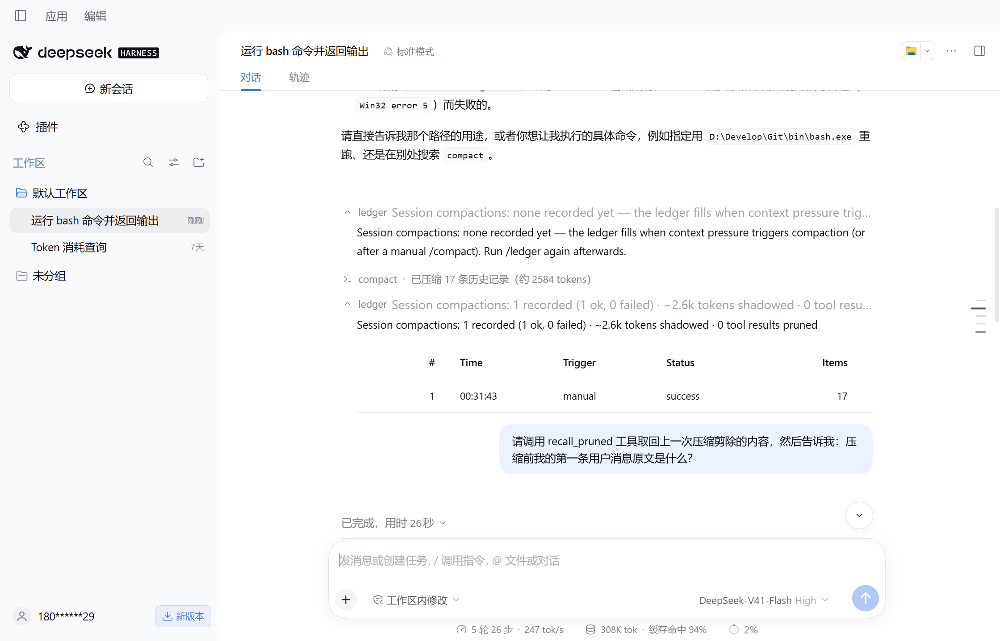
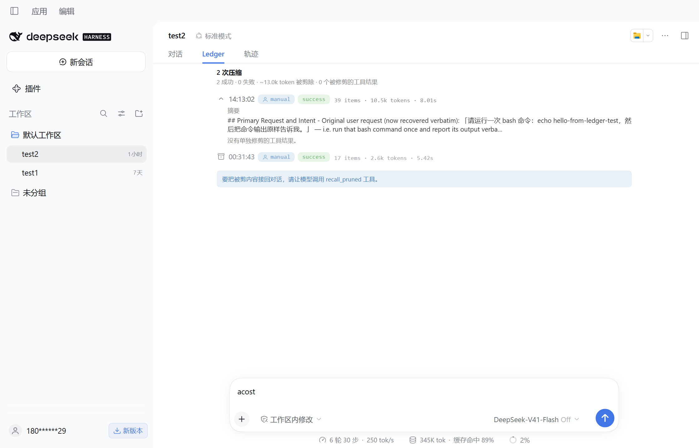

# dsh-compaction-ledger

[](https://www.npmjs.com/package/dsh-compaction-ledger)

[English](./README.md) | 中文

[DeepSeek Harness](https://github.com/deepseek-ai/deepseek-harness) 的压缩审计与取回插件——把上下文压缩拿走的东西接回来。

DSH 压缩会话时，较早的历史会从模型可见上下文中被遮蔽掉。持久会话日志逐字保留每一条被剪除的事件（官方原话："compaction hides superseded entries without deleting them"），但框架内没有任何东西把它读回来：模型丢了内容，用户只看到一个带两个数字的标记。本插件把每次压缩记成一本**账**，并给双方各留一条回路：

- **`recall_pruned`**（模型工具）——列出已记录的压缩，然后按精确日志地址（`seq`）从会话日志取回被剪内容，支持搜索过滤和字符预算。模型按需找回它失去的东西。
- **`/ledger`**（斜杠命令）——本会话的每次压缩：何时发生、触发方式（手动 `/compact` 还是自动压力）、成败、剪除了多少条历史和多少 token、哪些工具结果被单独修剪、摘要器路由。`/ledger full` 展开逐条明细；`/ledger json` 供脚本消费；`/ledger restore [last|<id>]` 向会话注入一条还原指针，让模型知道它可以取回内容。

零额外 LLM 调用，零额外存储——一切都从会话自身的持久事件流折叠而来。



## 为什么做这个

DSH Discussions 反复记录同一类失败：压缩静默截断，模型"忘记"会话早先的决策和工具输出，双方都无法知道丢了什么（[#3201](https://github.com/deepseek-ai/deepseek-harness/discussions/3201)、[#3542](https://github.com/deepseek-ai/deepseek-harness/discussions/3542)、[#4578](https://github.com/deepseek-ai/deepseek-harness/discussions/4578)）。与此同时，以"替换压缩器"为全部前提的 `billion-context` 是全生态下载量第一的插件。但替换压缩器是另一个赌注：本插件**与压缩器无关**——无论跑的是 DSH 自带压缩还是第三方压缩，被剪的内容都在日志里按精确地址躺着，账本把它读回来。

## 功能一览

- **`Ledger` 标签页** —— Chat / 轨迹旁边的真实标签页：本会话的压缩时间线，由宿主推送的投影实时驱动（无轮询）。总量带 + 每次压缩一张可展开卡片（展开显示摘要预览与被修剪的工具结果清单）。
- **`/ledger`** —— 首行摘要 + 表格：`# | 时间 | 触发 | 状态 | 条目 | Token | 耗时`
- **`/ledger full`** —— 逐条明细：失败压缩的错误链、摘要预览（含 provider/model）、被修剪工具结果清单（工具名、seq、token 估算）
- **`/ledger json`** —— 整本账的 JSON 输出
- **`/ledger restore last`** —— 向运行中的会话注入一条指针消息（"某次压缩剪除了 N 条，可用 recall_pruned 取回"），不唤醒回合
- **`recall_pruned`** —— 模型工具；无参列出账本，`{ compactionId }` 取回被剪内容（优先被修剪的工具结果，否则走整个被剪区段，从新到旧），`{ search }` 子串过滤，`{ maxChars }` 限制预算
- **渲染输出** —— 报告与取回结果在聊天中渲染为原生卡片（状态徽章、触发芯片、token 比例条、逐条取回卡片）

## 工作原理

一个纯[会话投影](https://github.com/deepseek-ai/deepseek-harness)折叠 `compaction/start` → `compaction/prune` → `compaction/summary` → `compaction/end` 事件括号以及紧随其后的替换 `tool/result` 追加：

- 逐条记录：触发方式（manual/auto，由 `sourceCommandId` 推导）、状态与错误链、摘要器路由、`shadowedSeqs`（被剪内容的精确日志地址）、被修剪工具结果（按 `callId` 解析出工具名）；
- 整会话总量，永不裁剪。

`recall_pruned` 通过官方持久化路径（`ctx.sessionPersistence` 只读句柄）读回原始事件——不碰原始日志文件，不读记录 seq 之外的任何消息数据。

### 端到端实测

在真实桌面会话中：`/compact` 压缩了 17 条历史（约 2.6k token）→ `/ledger` 显示 `1 recorded (1 ok, 0 failed) · ~2.6k tokens shadowed`、触发 `manual`、耗时 `5.42s` → `recall_pruned` 取回全部 17 条被剪条目，模型逐字引用了压缩前的用户消息。fold 与取回路径均对准 DSH `0.2.0-rc.2` 实际发出的事件形状。

## 渲染

报告通过聊天 Markdown 渲染器（`conversation.chat.commandview`）渲染，`recall_pruned` 调用通过工具卡槽（`tool.call.toolview`）渲染。客户端半边不可用时降级为等宽文本。官方转录中的压缩标记不做任何改动。

从没有客户端半边的版本升级？组合缓存按进程生命周期持有包的客户端声明——需要完全重启应用（页面刷新无效）槽位才会加载。

## 安装

在 DSH 内（插件页、插件管理工具或 CLI）：

```
dsh plugin --profile <profile> add dsh-compaction-ledger
```

## 配置

```yaml
- id: compaction-ledger
  name: dsh-compaction-ledger
  config:
    detailEntries: 50        # 保留的逐条明细数（总量始终覆盖全部）
    recallMaxChars: 20000    # 模型工具的默认取回预算
    summaryPreviewChars: 200 # 每条保留的摘要预览长度
    restoreEnabled: true     # /ledger restore
    language: en             # 报告语言：en | zh
```

## 说明与边界

- 账本记录的是框架压缩括号报告的内容。事件未落全的压缩（如压缩中途应用崩溃）会显示为 `running`——未配对的 start 本身就是可检测的设计。
- 取回只读本会话的日志。跨会话取回刻意不做：账本是回到*当前*对话的桥。
- 取回预算限制模型单次能拉回的量；内容本身永远不会从日志中丢失。

## 兼容性

- DSH `0.2.0-rc.1` 及之后的 `0.2.0-rc.x`（peer 范围 `^0.2.0-rc.1`）、cordis `^4.0.1`、Node ≥ 20。
- 宿主半边纯 ESM 无构建步骤；客户端半边手写 classic script（无打包器）。

## 开发

```
node --test      # 53 项单测，覆盖 fold/report/recall 与客户端半边
npm run sync     # 同步进本地 dev/desktop profile
```

## 许可证

MIT — 见 [LICENSE](./LICENSE)。
